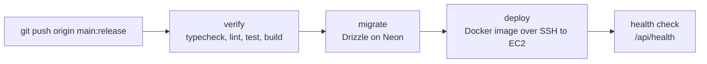

# System Design Simulator

**Live: https://sds.aniruddha81.tech**

Learn system design by running it: step-by-step lessons, a simulator you can break, and graded challenges with explained verdicts. Local-first (progress lives in the browser); optional accounts sync designs and progress across devices.

## What's inside

| Area | Route | What it is |
|---|---|---|
| Lessons | `/learn` | Tracks on foundations, building blocks, distributed systems, reliability, security and interviews, each step with a visual and a check question |
| Sandbox | `/sandbox` | Draw an architecture, run a discrete-event simulation, inject failures and read the results |
| Challenges | `/challenges` | Graded design problems with explained verdicts |
| Case studies | `/case-studies` | Worked designs of well-known systems with reference designs |
| Interview mode | `/interview` | Timed practice with a framework and tradeoff prompts |
| Reference | `/reference` | Latency numbers, estimation and other lookup material |

## Stack

Next.js (App Router) · React · TypeScript · MDX content · a custom simulation engine in a Web Worker · Drizzle ORM on Neon Postgres · better-auth · Vitest and Playwright.

## Getting started

```bash
npm ci
cp .env.example .env.local   # fill in values; accounts need DATABASE_URL and BETTER_AUTH_*
npm run dev                  # http://localhost:3000
```

This repo ships a modified Next.js. Read the relevant guide in `node_modules/next/dist/docs/` before changing framework-level code (see [AGENTS.md](AGENTS.md)).

## Scripts

| Command | Does |
|---|---|
| `npm run dev` / `build` / `start` | Develop, production build, serve the build |
| `npm run typecheck` | Generates route types, then `tsc --noEmit` |
| `npm run lint` | ESLint |
| `npm test` | Vitest unit and content tests |
| `npm run e2e` | Playwright production tests ([e2e/README.md](e2e/README.md)) |
| `npm run db:generate` / `db:migrate` | Drizzle migrations |

## Branches and deployment

Only two branches exist: `main` (development) and `release` (production). Pushing to `release` runs the whole pipeline in [.github/workflows/ci.yml](.github/workflows/ci.yml):



Nothing else triggers CI or deploys. Repo secrets: `DATABASE_URL_UNPOOLED`, `EC2_SSH_KEY`, `AWS_ACCESS_KEY_ID`, `AWS_SECRET_ACCESS_KEY` (the last two belong to an IAM user that can only open and close port 22 on the web security group for the length of a deploy). Host setup, domain and HTTPS: [docs/DEPLOY-AWS.md](docs/DEPLOY-AWS.md). Accounts and sync: [docs/DEPLOY.md](docs/DEPLOY.md).

## Docs

[docs/PLAN.md](docs/PLAN.md) (scope and completeness matrix) · [docs/DESIGN.md](docs/DESIGN.md) · [docs/OPERATIONS.md](docs/OPERATIONS.md) · [docs/a11y-checklist.md](docs/a11y-checklist.md)
