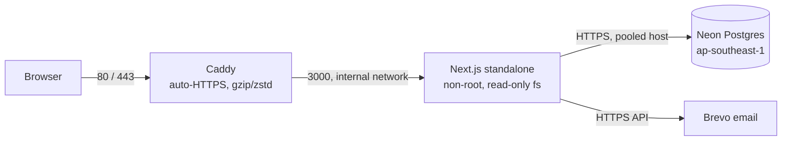

# Self-hosting on AWS EC2 (Docker)

The same app runs on Vercel (see `DEPLOY.md`) or as one Docker host. This is the Docker path.



## What exists

| Piece | Value |
|---|---|
| Region | `ap-southeast-1` (Singapore): same region as the Neon database |
| Instance | `t3.small` (2 vCPU, 2 GB), Ubuntu 24.04, 20 GB encrypted gp3, IMDSv2 only, 2 GB swap |
| Address | Elastic IP `13.250.70.115` (stays when the instance restarts) |
| Firewall | Security group `sds-web`: 80, 443 open; SSH (22) only from the admin IP |
| Access | SSH key pair `sds-prod` (private key at `~/.ssh/sds-prod.pem`, never committed) |
| Host files | `/opt/sds`: `docker-compose.yml`, `deploy/Caddyfile`, `.env.production` (mode 600) |

## Deploy or update

```bash
deploy/deploy.sh          # build locally, ship the image over SSH, restart, show status
```

No registry is involved: the 100 MB image is streamed with `docker save | ssh`. Roll back by deploying an earlier commit.

## Environment on the host (`/opt/sds/.env.production`)

`DATABASE_URL` (pooled Neon), `BETTER_AUTH_SECRET`, `BETTER_AUTH_URL` (public origin: **must match how users reach the site**), `NEXT_PUBLIC_APP_URL`, `BREVO_CLIENT_ID`, `BREVO_CLIENT_SECRET`, `EMAIL_FROM`, `CRON_SECRET`. After editing: `cd /opt/sds && docker compose up -d`.

## Turning on a domain (HTTPS)

1. Point an `A` record for the hostname at the Elastic IP.
2. On the host set `SITE_ADDRESS=your.host.name` in `/opt/sds/.env` (compose reads it) and set `BETTER_AUTH_URL` / `NEXT_PUBLIC_APP_URL` to `https://your.host.name` in `.env.production`.
3. `docker compose up -d`. Caddy obtains and renews the certificate itself.
4. Email is configured through Brevo (see `DEPLOY.md`).

## Retention job

Vercel Cron does not exist here. Add a daily cron on the host:

```bash
17 3 * * * curl -fsS -H "Authorization: Bearer $(grep ^CRON_SECRET /opt/sds/.env.production | cut -d= -f2)" http://127.0.0.1/api/cron/prune >/dev/null
```

## Operations

- Logs: `docker compose logs -f app`. Health: `curl http://localhost/api/health`.
- Security updates apply automatically (`unattended-upgrades`); `fail2ban` guards SSH.
- Cost: about USD 17/month for the instance plus a few dollars of storage and traffic. Stop paying: terminate the instance and release the Elastic IP.
