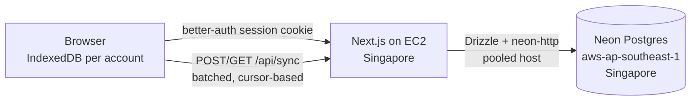

# Deploying with accounts and sync

Accounts are **optional**. Each signed-in account has its own IndexedDB workspace and cloud copy of designs, progress, reviews and run summaries. Guest and legacy browser work stays local; transfer it explicitly by exporting while signed out and importing after signing in. Account changes abort sync and reload the page so mounted editors cannot retain another account's records. Sync requests carry the initiating account ID, which must match the server session.

## Why these choices

- **Neon `aws-ap-southeast-1` (Singapore)**: matches the production EC2 region.
- **Drizzle ORM + `neon-http`**: no query engine binary, no connection pool to warm, one HTTPS round trip per query. Writes are single statements, so none needs an interactive transaction.
- **Better Auth**: email + password out of the box; GitHub and Google switch on when their env vars exist. Rate limits are stored in Postgres, so they hold across serverless instances.

## Environment

| Variable | Purpose |
|---|---|
| `DATABASE_URL` | Pooled Neon URL (host contains `-pooler`), using the restricted `sds_runtime` role. |
| `DATABASE_URL_UNPOOLED` | Direct Neon URL. Migrations only. |
| `BETTER_AUTH_SECRET` | 32+ random bytes. Rotate to invalidate all sessions. |
| `BETTER_AUTH_URL` | Public origin, e.g. `https://your-domain`. Also the allowed `Origin` for `/api/sync`. |
| `BREVO_CLIENT_ID` / `BREVO_CLIENT_SECRET` / `EMAIL_FROM` | Required for production account email. Verification stays enforced even if mail is misconfigured. `EMAIL_FROM` is `Name <address>`, authenticated in Brevo. |
| `CRON_SECRET` | Bearer token for `/api/cron/prune`; the host runs `deploy/check.mjs` daily inside the container. |
| `GITHUB_CLIENT_ID` / `GITHUB_CLIENT_SECRET` | Optional. |
| `GOOGLE_CLIENT_ID` / `GOOGLE_CLIENT_SECRET` | Optional. |

Copy `.env.example` to `.env.local` for development. Never commit real values.

## Email (Brevo)

Mail goes through Brevo's transactional API using a private machine-to-machine OAuth app limited to the `transactional.email:write` scope (`BREVO_CLIENT_ID` / `BREVO_CLIENT_SECRET`). The server mints a one-hour bearer token from `https://oauth.brevo.com/realms/partner/oauth/token` and caches it; no long-lived API key exists.

Set up (already done for `aniruddha81.tech`; sender `noreply@aniruddha81.tech`):

1. `brevo app create --name <name> --distribution private --m2m --scopes transactional.email:write --json`, then `brevo app secret rotate --app-id <id> --yes --json` to obtain a client secret (it is shown once).
2. In Brevo, authenticate the sending domain (Senders, domains & dedicated IPs): add the DKIM, SPF and DMARC records it lists to DNS.
3. Put the three variables in the host environment and restart.

Rotate the secret with the same `secret rotate` command; the old one keeps working for a short grace period.

## Release steps

1. Set runtime variables on EC2 as described in `DEPLOY-AWS.md`; keep migration owner credentials in GitHub.
2. `npm run db:generate` after any change to `src/server/db/schema.ts`, commit the new `drizzle/` files.
3. Merge verified pull requests to `main`, then from `main` to `release`. Only a `release` push migrates and deploys; both branches and pull requests run verification.
4. Monitor `GET /api/health` (returns 503 when the database is unreachable).

## Data model

| Table | Purpose |
|---|---|
| `user`, `session`, `account`, `verification` | Better Auth |
| `rate_limit` | Better Auth rate-limit counters |
| `sync_records` | One row per synced record: `(user_id, store, key)`, JSON `data`, `updated_at`, tombstone flag, global `seq` cursor |

Runs sync as RunKey + summary (never raw events); deleting a design deletes its runs in the cloud too. Deleting an account cascades to every session, account and sync record.

## Known limits

- Production email verification is always required. Sessions are checked against the database without a session cache cookie, so logout and revocation take effect immediately. Profile names are limited to 80 characters and auth POST bodies to 16 KiB.
- See `docs/OPERATIONS.md` for the runbook (restore, secret rotation, retention).
- Conflict rule: designs and reviews are last-write-wins by `updatedAt`; progress is max-merged on the client.
- Quotas: 5,000 synced records per user, 2 MB per design, 200 records per request.
