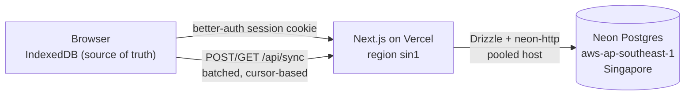

# Deploying with accounts and sync

Accounts are **optional**. The app is local-first (IndexedDB); signing in mirrors designs, progress and reviews to Postgres so a learner can switch devices. Runs stay local.

## Why these choices

- **Neon `aws-ap-southeast-1` (Singapore)**: the closest Neon region to Bangladesh. Vercel functions are pinned to `sin1` in `vercel.json`, so the app-to-database hop stays inside one region.
- **Drizzle ORM + `neon-http`**: no query engine binary, no connection pool to warm, one HTTPS round trip per query. Writes are single statements, so none needs an interactive transaction.
- **Better Auth**: email + password out of the box; GitHub and Google switch on when their env vars exist. Rate limits are stored in Postgres, so they hold across serverless instances.

## Environment

| Variable | Purpose |
|---|---|
| `DATABASE_URL` | Pooled Neon URL (host contains `-pooler`). Runtime. |
| `DATABASE_URL_UNPOOLED` | Direct Neon URL. Migrations only. |
| `BETTER_AUTH_SECRET` | 32+ random bytes. Rotate to invalidate all sessions. |
| `BETTER_AUTH_URL` | Public origin, e.g. `https://your-domain`. Also the allowed `Origin` for `/api/sync`. |
| `RESEND_API_KEY` / `EMAIL_FROM` | Optional. When both are set, sign-up requires email verification and password-reset emails are sent (Resend REST API). When unset, nobody is locked out and emails are not sent. |
| `CRON_SECRET` | Bearer token for `/api/cron/prune` (daily retention job in `vercel.json`). Vercel sends it automatically. |
| `GITHUB_CLIENT_ID` / `GITHUB_CLIENT_SECRET` | Optional. |
| `GOOGLE_CLIENT_ID` / `GOOGLE_CLIENT_SECRET` | Optional. |

Copy `.env.example` to `.env.local` for development. Never commit real values.

## Email (Resend)

Development uses the sandbox sender `onboarding@resend.dev`, which Resend delivers only to the account owner. The app detects it (`emailSandbox()` in `src/server/email.ts`) and never requires verification while it is in use, so no user can be locked out.

To email real users:

1. `resend domains create --name your-domain.com --region ap-northeast-1` (closest sending region to Bangladesh), add the DNS records it prints, then `resend domains verify <id>` until it reports verified.
2. Set `EMAIL_FROM="System Design Simulator <noreply@your-domain.com>"` and a send-only key (`resend api-keys create --name production --permission sending_access`) as `RESEND_API_KEY` in the host's environment.
3. From then on sign-up requires a verified email and password-reset mails go out. Users who signed up earlier must verify before their next sign-in.

## Release steps

1. Set the variables above in the Vercel project (Production and Preview).
2. `npm run db:generate` after any change to `src/server/db/schema.ts`, commit the new `drizzle/` files.
3. CI (`.github/workflows/ci.yml`) runs typecheck, lint, tests and build, then `npm run db:migrate` on `main`. Add the `DATABASE_URL_UNPOOLED` repo secret.
4. Monitor `GET /api/health` (returns 503 when the database is unreachable).

## Data model

| Table | Purpose |
|---|---|
| `user`, `session`, `account`, `verification` | Better Auth |
| `rate_limit` | Better Auth rate-limit counters |
| `sync_records` | One row per synced record: `(user_id, store, key)`, JSON `data`, `updated_at`, tombstone flag, global `seq` cursor |

Runs sync as RunKey + summary (never raw events); deleting a design deletes its runs in the cloud too. Deleting an account cascades to every session, account and sync record.

## Known limits

- Email verification and password reset are implemented but stay off until `RESEND_API_KEY` and `EMAIL_FROM` are set. Verify the sending domain in Resend first; once enabled, existing unverified users must verify before signing in.
- See `docs/OPERATIONS.md` for the runbook (restore, secret rotation, retention).
- Conflict rule: designs and reviews are last-write-wins by `updatedAt`; progress is max-merged on the client.
- Quotas: 5,000 synced records per user, 2 MB per design, 200 records per request.
