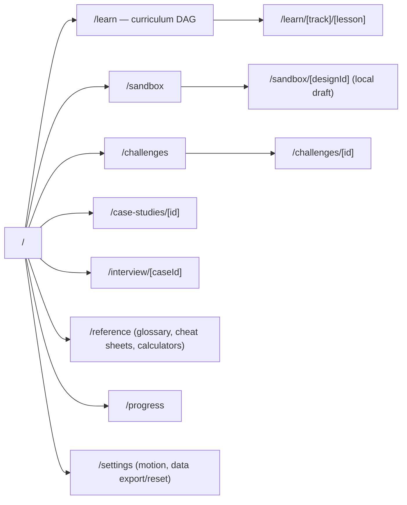
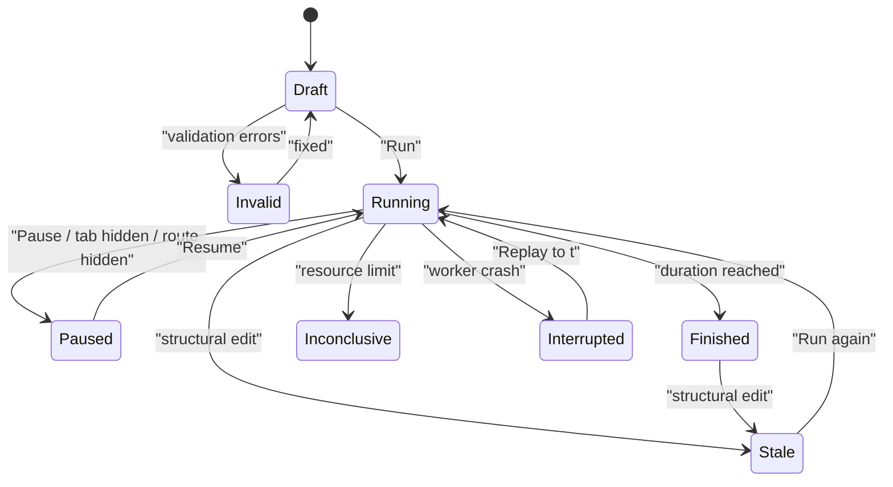
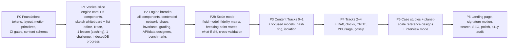

# System Design Simulator — Master Plan (FINAL v5, agreed by Claude and Codex)

> **Status: FINAL — agreed 2026-10-24 after 5 review rounds between Claude and Codex.**
>
> Codex sign-off: "I approve v5 as the implementation plan for its declared scope. All review blockers are resolved, including reproducible starting state and correct cold-cache fill semantics. Fidelity limits, deferred features, and release validation are explicit."

## 0. Scope and definition of "complete"

"Every edge case" is bounded by **Appendix A (Completeness Matrix)**. A topic counts as covered only when its row has all of the following:

- a lesson with measurable objectives,
- at least one hands-on activity,
- an assessment that tests transfer to a new situation,
- the simulator capability it relies on,
- its **known limitations**, which the learner sees in the UI.

Anything that is not in the matrix is out of scope until a row is added. Every row must be green before launch.

Activity types (used in the matrix):

| Code | Activity | Meaning |
|---|---|---|
| **R** | Runnable simulation | Uses the shared discrete-event engine (§5) |
| **M** | Focused model | A dedicated deterministic stepper for one algorithm (Raft, CRDT, isolation levels, ...) (§6) |
| **V** | Visual explainer | An animated, scrubbable diagram. Not a simulation, and labelled as such |
| **C** | Calculator | Estimation tools: capacity, storage, bandwidth, nines → downtime, cost |
| **Q** | Assessment | Questions with parameterised variants |

## 1. Product pillars

1. **Learn**: Brilliant-style step lessons, with an interactive element in every step.
2. **Simulate**: a sandbox where you build a system, drive traffic, inject failures and read the metrics.
3. **Practice**: graded challenges with reproducible, explained verdicts.
4. **Interview**: mock interviews built on the case studies, with a rubric and reference solutions.
5. **Reference**: glossary, cheat sheets, latency numbers and the estimation toolkit, all searchable.

## 2. Pedagogy model

- **Prerequisite DAG**: every lesson declares `requires: [lessonId]`. The curriculum map renders this DAG. Locked lessons stay viewable, with a "you may be missing X" notice; nothing is hard-locked.
- **Placement**: each track has an optional placement check. Passing it marks lessons as "tested out", which is shown differently from "completed".
- **Objectives**: each lesson lists 2–5 objectives ("Explain why p99 rises before CPU hits 100%"). Each objective maps to at least one assessment item.
- **Mastery**: a lesson is *mastered* when the learner scores ≥ 80% on a mastery check drawn from **parameterised variants** that they have not seen. Retrying the same item never counts twice. Variants come from templates (numbers, topology and failure randomised from a seed).
- **Feedback**: a wrong answer shows a targeted explanation for the chosen distractor, then a link back to the exact step (remediation), then a fresh variant.
- **Worked solutions**: every challenge and case study has a step-by-step worked solution and ≥ 1 alternative design with its trade-offs.
- **Spaced review**: missed objectives enter a review queue (simplified SM-2) that is due on the dashboard.
- **Content revisions**: progress is keyed by stable `objectiveId`/`stepId`, not by position.
  - A removed step drops out of the progress calculation.
  - A *major* revision keeps "completed" but shows a badge saying the lesson was updated since completion.
  - Mastery is retained unless an objective is new.

## 3. Curriculum

Every lesson, case study and challenge follows a template, validated by schema (§9).

**Track 0 — Foundations**: how the web works (DNS, TCP, TLS, HTTP/1.1/2/3, QUIC); latency numbers; bandwidth vs latency; throughput; Little's law; percentiles and tail latency; fan-out tail amplification; availability nines; back-of-envelope estimation (QPS, storage, bandwidth, memory, servers); network egress cost.

**Track 1 — Building blocks**:

- API design: REST, gRPC, GraphQL, WebSockets/SSE/long-poll, pagination (offset vs cursor), versioning and compatibility, idempotency keys.
- Load balancers: L4/L7, algorithms, health checks, sticky sessions, connection draining.
- Stateless services and horizontal scaling; autoscaling.
- Caching: cache-aside, read-through, write-through, write-back, eviction, TTL, stampede/dogpile, negative caching, invalidation.
- CDN: edge caching and origin shielding.
- Databases: SQL vs NoSQL families, indexes, B-tree vs LSM, write amplification.
- Transactions: isolation levels and anomalies (dirty read, non-repeatable read, phantom, lost update, write skew), uniqueness constraints and reservation races, optimistic vs pessimistic locking.
- Schema evolution and online migrations (expand/contract).
- Replication: leader/follower, sync vs async, multi-leader, leaderless, quorums, read repair, anti-entropy, hinted handoff, tombstones.
- Partitioning: range, hash, consistent hashing, rebalancing, hot keys.
- Queues and streams: at-least-once, at-most-once, effectively-once, ordering, DLQ, back-pressure, consumer groups.
- Stream processing: windows, watermarks, late data, deduplication.
- Storage: blob/object storage, durability vs availability, erasure coding.
- Other building blocks: search (inverted index), rate limiting algorithms, service discovery, proxies and API gateways.

**Track 2 — Distributed systems**: CAP and PACELC; consistency models (linearizable, sequential, causal, read-your-writes, monotonic reads, eventual); consensus (Raft); leader election with leases and fencing tokens; clocks (physical drift, Lamport, vector, hybrid); idempotency; retries/backoff/jitter; timeouts and deadlines with propagation; circuit breakers; bulkheads; load shedding; distributed transactions (2PC, sagas, transactional outbox); CRDTs and OT; gossip and failure detectors.

**Track 3 — Reliability and operations**: metrics, logs and traces; SLI/SLO/error budgets; failure modes (cascading failure, thundering herd, retry storm, metastable failure, split brain, gray failure); disaster recovery (RPO/RTO, backups); multi-region (active-passive, active-active); deployments (blue/green, canary, feature flags, rollback); capacity planning.

**Track 4 — Security and data**: authN/authZ, sessions vs JWT, OAuth/OIDC flows, encryption in transit and at rest, key management and secrets, DDoS mitigation, abuse prevention, multi-tenancy isolation, privacy and data deletion.

**Track 5 — Case studies**: URL shortener, pastebin, rate limiter, key-value store, distributed cache, news feed, chat, notification system, Twitter timeline, Instagram, YouTube/video streaming, Uber/ride matching, proximity service (geohash/quadtree), web crawler, typeahead, search engine, Google Docs (OT/CRDT), Dropbox/file sync, payment system, ticket booking, hotel booking, leaderboard, ad-click aggregation, metrics/monitoring system, job scheduler, stock exchange (matching engine).

Each case study includes requirements (functional and non-functional), worked estimates, API, data model, high-level design, deep dives, alternative designs, failure scenarios (each one runnable), and a rubric.

**Track 6 — Interview craft**: the framework (requirements → estimates → API → data model → high level → deep dives → trade-offs → wrap-up), clarifying questions, how to communicate trade-offs, and common mistakes.

## 4. Information architecture



Invalid slugs call `notFound()` and render a branded 404 page with search. Renamed slugs redirect permanently (`redirects` in `next.config.ts`, generated from content metadata).

## 5. Simulation engine (shared, operational simulations)

### 5.1 Execution model

- Pure TypeScript package `src/engine` with no DOM dependencies. It runs in a **Web Worker** and also in Node for tests and grading.
- **Time**: integer **microseconds** (`number`, safe up to 2^53 µs ≈ 285 years). Runs are capped far below that.
- **Sampling rule**: every sampled duration (service time, latency, backoff) is `max(1, ceil(sampleUs))`. Time therefore always advances by at least 1 µs per causal hop, and zero-time loops cannot form at runtime.
- **Event queue**: a binary heap ordered by `(time, priority, seq)`, where `seq` is a monotonically increasing insertion counter. This gives a total, deterministic order for events at the same time.
- **Same-time precedence**, from first to last:
  1. chaos/failure transitions;
  2. live edits;
  3. service completion;
  4. response delivery;
  5. deadline/timeout;
  6. retry scheduling;
  7. new arrival.

  A response delivered at exactly the deadline time counts as on time: deadlines are inclusive.
- **Event cursor**: `(timeUs, seq)` identifies a point in a run exactly. Live edits, replay-to and crash recovery all use cursors, not bare times.
- **Randomness**: one seeded PRNG (`xoshiro128**`). Each component gets its own sub-stream derived from `(seed, componentId)`, so adding a node does not perturb the random numbers of other nodes.
- **Run identity**: `RunKey = {engineVersion, scenarioVersion, designHash (canonical JSON, sorted keys), seed, settings, chaosTimeline, liveEditLog}`. The same RunKey always gives byte-identical results. Wall-clock time and render speed never feed into the engine.
- **Run record**: a hash alone cannot rebuild an edited or deleted design, so each run record stores the **immutable inputs**:
  - the canonical design snapshot, content-addressed and deduplicated by `designHash`;
  - the scenario, the chaos timeline, and the `liveEditLog` entries with their cursors;
  - a compact **results summary** (headline metrics, verdicts, invariant counts).
- **Replay** requires an identical **`replayCompatId`**. This engine constant changes whenever *any* deterministic behaviour or metric computation changes, including minor fixes.
  - CI enforces it with golden-run hashes: if a golden output changes and `replayCompatId` was not bumped, the build fails.
  - On a mismatch, only the stored summary is shown, and the learner is offered "Run fresh on the current engine".
- **Execution slices**: the worker runs events for ≤ 8 ms of wall time, posts a snapshot, then yields (`setTimeout 0` / `MessageChannel`). The speed setting maps simulated time to wall time: 0.1×, 1×, 10× or "max". Pause and single-step (one event, or 1 ms of sim time) are supported.
- **Visual sampling** is independent of the engine. The engine emits *all* metrics, and only a sampled subset of request traces is sent for packet animation. The sampling rate adapts to the frame budget.

### 5.2 Request model

```ts
type Request = {
  id: string; logicalId: string; attempt: number;
  op: "read" | "write" | "custom"; opName: string;
  key: string; version?: number; payloadBytes: number;
  idempotencyKey?: string; deadlineUs: number; parentId?: string;
};
```

Each request type in a scenario has a **route program**, a small, typed DSL that is validated before a run:

| Step | Behaviour |
|---|---|
| `call(target, opts)` | Synchronous call: waits for the response. `opts` = timeout, retries `{max, backoff, jitter, retryOn}`, `propagateDeadline`, `cancelOnTimeout` |
| `parallel([...], join)` | `join` is `all`, `any`, `quorum(k)` or `firstN(n)`. Losers are cancelled or allowed to finish, per the step's option |
| `branch(condition)` | `condition` is evaluated against **component state**, e.g. `cacheHit(key)`, `shardOf(key)`, `leaderAlive`, `rateLimitOk`. It is never a fixed probability, except for the `prob(p)` step, which is explicitly labelled as probabilistic |
| `publish(queue)` | Asynchronous: the ack is returned when the queue accepts the message. A consumer route runs later |
| `respond(status)` | Ends the route and returns `status` to the caller |

Further rules:

- **Responses** travel back along the call stack. Each hop pays link latency plus serialization on a **shared, contended** link (§5.4). Request size and response size are specified separately per endpoint.
- **Timeouts**: the caller stops waiting. With `cancelOnTimeout` off (the default, to teach wasted work), the callee keeps working and its result is discarded and counted as **wasted work**.
- **Retries** create a new attempt with the same `logicalId`. A non-idempotent write that is retried after a lost ack produces a **duplicate effect**, which is counted as a correctness violation (§5.6). An idempotency key with a dedup store prevents it.

### 5.3 Components (operational)

Shared component parameters:

- `concurrency` (workers),
- `serviceTime` per op (constant, exponential, lognormal or an empirical histogram),
- `queueCapacity`, `queueDiscipline` (FIFO, LIFO, priority),
- admission policy (reject when full / shed lowest priority),
- `costPerHour`, `region`, `zone`.

| Component | Specific behaviour |
|---|---|
| Client / traffic source | Workload profile (§5.5). Measures end-to-end latency per logical request |
| DNS | TTL, resolution latency, failover records |
| CDN / edge | Per-region cache with real keys and eviction, origin shield, origin fallback |
| Load balancer (L4/L7) | Round robin, weighted, least-connections, P2C, consistent hash. Active health checks (interval, thresholds), connection draining |
| API gateway | Auth latency, routing, request-size limits |
| Rate limiter | Token bucket, leaky bucket, fixed window, sliding window. Local or centralised state |
| Service | Stateless; cold start, CPU-bound vs IO-bound service time, memory limit → OOM restart |
| Cache | Capacity in bytes, real key store (LRU/LFU/TTL), so the hit rate *emerges* from the key distribution. Request coalescing toggle; cold start after restart |
| Relational DB | Leader + replicas, sync/async/semi-sync replication with lag, WAL durability setting, connection pool limit, row locks (simple lock table, so hot-row contention emerges), unique constraints, read/write split |
| KV / wide-column store | Partitions on a consistent-hash ring, replication factor N, R/W quorums, hinted handoff, read repair, tombstones, rebalancing on node add/remove |
| Queue / log | Partitions, ordering per partition, consumer groups, visibility timeout, redelivery, DLQ after N attempts, retention, back-pressure |
| Worker / consumer | Pulls from a queue, with a configurable route |
| Object store | High latency, high durability, per-request + per-GB cost |
| Search index | Index lag (eventual) vs the source DB |
| Dedup / idempotency store | TTL, keyed by idempotency key |
| Autoscaler | Target metric, min/max, cooldown, provisioning delay, warm-up |
| Circuit breaker / bulkhead | Edge or node policies |
| Region / zone groups | Containers that define latency, egress cost and failure domains |

### 5.4 Network

- Each edge is a link with `latency` (distribution), `bandwidth`, `lossRate` and `egressCostPerGB`.
- **Bandwidth is contended.** Each link *direction* is a FIFO serializer with capacity `bandwidth` bytes/s. Transfer time = wait behind earlier transfers + `bytes / bandwidth` + propagation latency. Aggregate throughput therefore saturates, and a saturated link shows up in the bottleneck report like any other resource.
- Each node can also have an optional NIC capacity that is shared by all of its links.
- Latency between regions comes from a fixed matrix, shown in the UI.
- Links are **directional**: A→B can drop while B→A still works.
- A lost packet looks like a timeout to the sender. A lost **response** means the work was done but not acked, which is the classic duplicate-write trap.

### 5.5 Workload

- **Arrival process**: Poisson, constant, ramp, step, spike, diurnal, or replay of a user-supplied curve (CSV, validated).
- **Operation mix**: per request type.
- **Keys**: uniform, Zipf(s), hotspot (one key = x%), or sequential.
- **Payload size**: a distribution per operation.
- **Sessions**: optional, for sticky-session and read-your-writes scenarios.

### 5.6 Failures, chaos and recovery semantics

**Node states**:

| State | Meaning |
|---|---|
| `up` | Normal |
| `degraded(slowFactor)` | Service times are multiplied by `slowFactor` |
| `gray(errorRate)` | Passes health checks but fails requests |
| `down` | Dead |
| `restarting(warmupUs)` | Coming back up |

**What happens when a node goes `down`**:

- In-flight and queued requests on it are lost, and callers observe timeouts.
- State is kept or lost according to the component's durability:
  - cache: lost;
  - DB: committed WAL is kept;
  - async-replicated writes that were not yet shipped are **lost on failover**, recorded as `ackedWriteLost`;
  - queue: persisted messages are kept, while unacked deliveries become visible again after the visibility timeout.

**Failover**:

- Detection delay = failure detector (heartbeat interval × threshold), then an election delay.
- Without **fencing**, the old leader can come back and accept writes, which produces a split-brain → conflicting writes are recorded.

**Recovery**:

- `restarting` → catch-up replication (lag drains at a modelled rate) → `up`.
- A cache comes back empty.

**Chaos events** go on a timeline:

- kill, degrade, gray, partition (set of directional links), packet loss, clock skew (for lease demos), zone/region outage, dependency latency injection, traffic spike;
- each event has a start and an optional end;
- events compose: latency adds; loss probabilities combine as `1 − Π(1 − p)`; `down` overrides `degraded`; overlapping events of the same kind on the same target are **rejected** by timeline validation.

### 5.7 Live edits during a run

- **Parameter edits** (sliders) are allowed in the sandbox.
  - The UI posts the edit to the worker.
  - The engine applies it at the **next event boundary** and acknowledges it with the cursor `(timeUs, seq)`.
  - Only acknowledged edits enter `liveEditLog`, so replay applies them at the identical point.
- What each kind of edit does to work that already exists:

  | Edit | Effect |
  |---|---|
  | `concurrency` increase | New workers start immediately and pull from the queue |
  | `concurrency` decrease | Surplus workers finish their current request, then retire |
  | `serviceTime` | Applies to requests that **start** service after the edit. In-service requests keep their sampled completion |
  | `queueCapacity` decrease | Excess queued requests are dropped newest-first and counted as `drops(edit)` |
  | Cache capacity decrease | Immediate eviction according to the policy |
  | TTL change | Applies to entries written after the edit |
  | Timeout / retry / breaker policy | Applies to **new attempts**. Scheduled timers are unchanged |
  | Workload rate/mix | Applies from the next arrival that is scheduled |
  | Chaos edits | Allowed only for events that start after the cursor |
- **Structural edits** (add or remove a node or edge) stop the run. The results stay visible and are marked **"stale: design changed"**.
- Graded runs freeze the design.

### 5.8 Metric definitions

| Metric | Definition |
|---|---|
| Offered | Logical requests generated |
| Admitted | Offered minus those rejected at admission (rate limiter, full queue, shed) |
| Succeeded / Failed | Final outcome per **logical request** after all retries |
| Attempts | All attempts, including retries. Shows retry amplification = attempts ÷ offered |
| Unfinished | Still in flight when the run ends after drain. Reported separately, never silently dropped |
| **Goodput SLI (primary)** | Logical requests that **succeeded, were correct (no invariant violation attributed to them) and finished within their deadline**, divided by offered requests. Fast-failing requests cannot game it |
| Measurement cohort | Requests that **arrived** during the measurement window. Their outcomes are followed through the drain period. Warm-up arrivals are excluded even if they finish later |
| Latency | Measured at the client from first-attempt start to final outcome. Two histograms: **success latency** (graded), and **all-outcomes latency** (failures at their failure time; diagnostic only). A latency SLO is graded only *jointly* with a goodput SLO, so converting slow requests into fast failures cannot pass |
| Percentiles | From an HDR-style log-bucketed histogram (≤ 1% relative error). p99 is shown only when the window has ≥ 1,000 samples, p999 only with ≥ 10,000. Otherwise the UI shows "insufficient data" |
| Windows | Warm-up (excluded) → measurement → drain (no new arrivals, until the max deadline). Zero traffic gives **N/A**, not 0 |
| Availability (request-based) | Succeeded ÷ offered within the measurement window. The UI states clearly that this is *not* yearly nines; those are taught with the C-calculator |
| Throughput | Offered/s, admitted/s, completed/s, all shown together |
| Per node | Utilisation, queue length (time-averaged and max), in-flight, drops, errors, latency percentiles |
| Cost | Σ component cost-hours + egress + per-request costs, extrapolated to per month and labelled as an estimate |

**Correctness invariants**: checked continuously, and each violation records the time and request IDs.

- `ackedWriteLost` — a write acknowledged to a client is later lost.
- `duplicateEffect` — the state effect of one `logicalId` was applied more than once, **whether or not an idempotency key was present**. The dedup store is modelled honestly:
  - atomic conditional insert vs non-atomic check-then-act (the race is reproducible);
  - concurrent duplicates in flight;
  - key TTL expiry before a late retry;
  - loss of keys on restart when the store is not durable.

  A key that is present but deduplicated incorrectly still triggers the violation.
- `staleRead` — the read returned a version older than the latest write acked *before the read started*. Per-session variants are `readYourWrites` and `monotonicRead`.
- `oversell` / `uniquenessViolated` — inventory below 0, or a duplicate unique key.
- `splitBrainWrite` — writes to the same key were accepted by two different nodes during **overlapping intervals in which each believed itself leader**, in any terms, and the storage layer did not reject the stale one with a fencing token.
- `orderingViolated` — out-of-order consumption where the scenario requires per-key order.

### 5.9 Validation and resource limits

**Pre-run validation** (shown inline; Run is disabled until it is clean):

- no traffic source;
- unreachable nodes;
- a route that calls a missing or incompatible target;
- zero-time cycles (every edge latency and service time must be > 0, and route recursion depth must be ≤ 32);
- non-finite or out-of-range parameters;
- probabilities outside [0, 1];
- quorum k > n;
- overlapping chaos events;
- graph larger than the limits.

**Hard limits per run** (configurable within a ceiling):

| Limit | Ceiling |
|---|---|
| Simulated duration | ≤ 1 h |
| Total events | ≤ 50M |
| Live requests (in flight + queued + pending retries + timers) | ≤ 250k |
| Nodes | ≤ 200 |
| Edges | ≤ 600 |
| Trace retention | Ring buffer, last 10k requests |
| Metric series | Fixed-size downsampled buffers |
| Event heap | ≤ 2M entries |
| Simulated stored keys (per cache/DB node) | ≤ 1M. A larger keyspace is a **validation error**. The fix is to use Scale mode, or to create an explicit, labelled reduced scenario (§8A.1). There is never silent scaling |
| Queued messages (all queues) | ≤ 500k |
| Payloads | Sizes only. No payload bytes are ever allocated |
| Per-run memory | Engine self-estimate ≤ 256 MB |

Hitting a limit stops the run with the verdict **"Inconclusive: resource limit X reached at t=…"**, plus guidance (for example "your retry policy amplified load 40×").

Overload is *not* treated as an error. A saturated system is a valid result, and its metrics show it.

### 5.10 Crash recovery

- Worker `error` or `messageerror` terminates the worker.
- **Watchdog**: the worker heartbeats every 1 s *while running*. The watchdog evaluates only when the run state is Running **and** `document.visibilityState === "visible"`. Paused runs and hidden or suspended tabs are never judged.
  - On becoming visible again, the UI does a ping/pong liveness check before evaluating.
  - 5 s without a heartbeat under those conditions counts as a crash.
- Recovery replays to the **last acknowledged cursor**.
- The last displayed results are kept and marked "run interrupted".
- The learner gets **Restart** and **Replay to t** options. Replay is possible because runs are deterministic: the RunKey is replayed in a fresh worker to the same sim time.
- No engine checkpoints are taken (not needed, since replay is exact).



## 5A. Planet-scale load simulation ("billions of requests")

Simulating every request individually does not fit in a browser at internet scale. 1B requests/day ≈ 11.6k rps on average, and real peaks reach millions of rps. The engine is therefore **multi-fidelity**, and every result states which mode produced it.

| Mode | Engine | Scale | Used for |
|---|---|---|---|
| **Exact** | DES (§5) | ≤ ~20k rps, ≤ 1 h sim, ≤ 1M keys per store | lessons, challenges, single-request traces, correctness invariants |
| **Scale** | Fluid/flow model (§5A.1) | 10k → 100M+ rps, days of sim time in seconds | capacity planning, "what breaks at 10×", global multi-region, planet-scale reference designs |
| ~~Hybrid~~ | **Deferred** (post-launch candidate) | — | Exact traces plus bounded Scale estimates already cover the requirement. Hybrid needs a validated coupling of sampled and background work (shared locks, cache state, replication) before it may be offered |

### 5A.0 Fidelity capability matrix

For every feature and mode, the matrix says **supported**, **approximate (validated envelope)** or **unsupported**. If a design uses a feature that is unsupported in the selected mode, the **affected predictions are disabled**, with the reason ("LFU cache: Scale mode can't predict hit rate; run in Exact"). A low-confidence chip is never a substitute for missing semantics. The full matrix lives in `content/fidelity.yaml`; the engine reads it and CI checks it. A summary:

| Feature | Exact | Scale |
|---|---|---|
| Serial `call`, `branch` (state-based), `respond` | supported | approximate (independence across hops) |
| `parallel` all / any / quorum | supported | approximate (independence assumed, labelled) |
| `publish` + consumers | supported | approximate (fluid queue) |
| Timeouts, retries, backoff | supported | approximate (rate feedback, from tail probability) |
| Cache LRU, fixed object size, stationary Zipf, optional TTL | supported | approximate (Che / TTL-Che) |
| Cache LFU, variable object sizes, heavy invalidation, popularity shifts | supported | **unsupported** |
| Cache cold start / restart | supported | approximate (fill model, §5A.1) |
| Row locks / hot-row contention, dedup races, isolation | supported | **unsupported** |
| Replication lag | supported | approximate (rate model) |
| Failover, split brain, fencing | supported | capacity effect only; correctness **unsupported** |
| Contended links, egress | supported | approximate (fluid edges) |
| Autoscaling | supported | supported (rate model) |
| Chaos timeline | supported | supported (capacity, health and partition multipliers) |
| Correctness invariants | supported | **unsupported**, so correctness shows as "unknown" |
| Percentiles | supported (HDR) | approximate only inside the envelope; otherwise "unavailable" |

### 5A.1 Fluid model semantics

Time is stepped with an adaptive Δt of 10 ms–1 s. Δt halves while any queue or rate changes by more than 10% per step.

**Two regimes per node, so waiting is never counted twice**:

1. **Stable** (ρ < 1 and no backlog above the stationary mean):
   - Mean wait comes from Allen–Cunneen (G/G/c), or Erlang C when the node is M/M/c.
   - The **waiting-time distribution** is approximated as `P(wait > 0)` (Erlang-C / Allen–Cunneen probability of delay), multiplied by an exponential conditional wait with the matching mean. This is a standard approximation, validated against DES in CI per §5A.3.
   - The fluid backlog is ≈ 0 and is **not** added.
2. **Overload / transient** (ρ ≥ 1, or the backlog exceeds the stationary mean, e.g. after an outage):
   - Bounded fluid queue: `backlog' = arrivals − completions − drops`, with `completions = min(capacity, backlog/Δt + arrivals)`, and drops when the backlog exceeds the queue capacity.
   - Waiting = `backlog / capacity` (FIFO), and **no stationary term** is added.
   - When capacity = 0 (outage), every arrival fails or times out per policy, and latency is reported as **"unavailable"**. Every division is guarded.

**End-to-end latency**:

- Per-node sojourn distributions are discretised on the same log-bucketed histogram as the HDR metrics.
- Composition rules:

  | Construct | Rule |
  |---|---|
  | Serial calls | Convolution |
  | `branch` | Mixture, weighted by the branch rates |
  | `parallel(all)` | Max (CDF product) |
  | `any` | Min |
  | `quorum(k)` | k-th order statistic |
  | Retries | Mixture, shifted by the backoff |

- The **timeout tail** `1 − CDF(deadline)` feeds the timeout and retry rate equations.
- Hops are assumed independent, and this is labelled.
- Percentiles are shown only when every node on the path is inside the validated envelope. Otherwise they read **"unavailable in Scale mode"**.

**Cache**: Che's approximation is used only for LRU with stationary Zipf and fixed object size, plus the TTL-cache variant for TTL. Everything else is unsupported (§5A.0).

**Cold start and restart**: the cache restarts **empty**. Occupancy then grows only from **successful, completed origin fills of distinct keys**:

- **Fill rate** = the rate of successful origin responses for misses, multiplied by the probability that the key is not already cached or being filled.
- The probability that a key is new comes from the Zipf distinct-key coverage curve.
- With coalescing on, concurrent misses for one key produce one fill. With it off, they cause duplicate origin load but still only **one** cached object.
- **Occupancy is bounded** by capacity, and reduced by TTL expiry and replacement.
- **Failed or timed-out origin fetches add nothing**. A cache in front of a dead origin stays cold, and the prediction shows no false recovery.

The fill model lets the stampede and the DB spike after a restart show up instead of an instantly restored hit rate.

**Other dynamics**:

- replication lag = backlog of `writeRate − applyRate`;
- autoscaling = capacity steps after the provisioning delay;
- links = fluid edges with bandwidth capacity.

**Outputs**:

- per node and link: utilisation, backlog, drops, approximate latency;
- global: the **estimated timely-success ratio** (successes within the deadline ÷ offered), with **correctness: unknown**. This is deliberately *not* called goodput, because goodput (§5.8) needs correctness;
- cost/month and cost per million requests.

**Conservation** (per node per step, in counts): `backlogEnd = backlogStart + arrivals − completions − drops`. Internal attempts and fan-out are accounted separately from client logical requests.

### 5A.2 Scale tools

- **Breaking-point sweep**, in two explicitly labelled kinds, because they give different answers:
  - **Independent levels**: each load level starts fresh with a warm-up fill period, so cache, autoscaling and backlog state is reset.
  - **Continuous ramp**: state carries over between levels, which exposes retry storms, autoscaling lag and cache churn.
- **Sweep bounds**:

  | Bound | Limit |
  |---|---|
  | Load levels | ≤ 12, log-spaced from 1× to 1000× |
  | Sim time per level | ≤ 30 min |
  | Fluid steps per sweep | ≤ 5M |
  | Wall time | ≤ 120 s, with a progress bar (level k of n) and **Cancel**, which keeps completed levels |

- **Steady state**: reached when, for 30 sim-seconds, every node's utilisation and backlog change by < 1% and outputs match inputs within 1%. If a level never reaches steady state within its cap, it is reported as **"unstable — no steady state"**, which is itself a finding (overload or oscillation). It is never silently averaged.
- **Failure ladder**: the **predicted sequence under the selected scenario**. For example: "3.2× → DB primary saturates → 4× retry amplification 2.7× → 5× LB queue overflow → timely-success 41%".
  - It is shown as an animated heat sequence on the canvas, with a "Why?" explanation per rung.
  - Remedies are **suggestions to test**. "Try it" creates a what-if variant (e.g. "+1 read replica") and runs it. A remedy is shown as **verified** only after that what-if run actually improves the ladder.
- **What-if diff**: two designs, or one design at two loads/scenarios, side by side, with deltas on every metric and on the failure ladder.
- **Planet-scale reference designs**: YouTube, WhatsApp, Uber, Twitter/X timeline, Netflix-style CDN, Stripe-style payments, Discord, Google-style search.
  - Each one is built from public, cited approximate numbers and labelled "illustrative".
  - Each has a scenario pack: normal day, peak event, region outage, hot key/celebrity, dependency brownout, DDoS.
  - Learners can open, break and modify any of them.

### 5A.3 Validation of Scale mode (CI)

On the benchmark scenarios in the overlap range (1k–20k rps), Scale mode is compared with Exact mode across K seeds:

| Check | Tolerance |
|---|---|
| Steady utilisation | ±5 percentage points |
| Success p50/p99 | ±25% |
| Timeout-tail fraction | ±25% relative |
| Transient: node outage and recovery (backlog peak and recovery time) | ±25% |
| Cache cold start (time until hit rate reaches 90% of steady) | ±25% |
| Cold cache with the origin unavailable | Hit rate must stay ≈ 0 until the origin recovers, then warm within the tolerance above |
| Concurrent misses for one key with a slow origin (coalescing on and off) | Origin load and occupancy must match DES within ±25% |
| Overload: drop rate at 1.5× capacity | ±10% |
| **Failure ladder**: first saturating component and the order of the first three rungs | must match |
| Δt refinement: halving Δt changes the headline outputs | < 2% |
| Sweep determinism | same inputs give identical results |

A design outside the validated envelope (e.g. heavy-tailed service with CV > 4, or sustained ρ > 0.95) gets its percentiles marked "unavailable", and the rest of its outputs carry a **"low-confidence"** chip.

## 6. Focused models (activity type M)

These are separate deterministic steppers with a shared interface:

```ts
interface Model<S, A> {
  init(seed): S;
  actions(S): A[];
  step(S, A): S;
  invariants(S): Violation[];
  scenarios: Script[];
}
```

The UI gives play/step/scrub, injects user actions ("partition node 3", "deliver this message", "advance clock"), and shows violated invariants.

| Model | Teaches |
|---|---|
| Raft | Election, log replication, commit index, partitions, leader stickiness, term invariants |
| Isolation levels | Transaction scheduler over interleavings: Read Committed / Snapshot / Serializable, showing the anomalies each one allows |
| Consistent hashing ring | Virtual nodes, rebalancing, key movement |
| Clocks | Lamport / vector / HLC with message diagrams |
| 2PC and Saga | Coordinator failure, blocking, compensations |
| CRDTs (G-Counter, OR-Set, RGA text) and OT | Convergence under reordering |
| Gossip and failure detection | Spread rate, phi-accrual |
| Quorum read/write | Sloppy quorum, read repair, tombstone resurrection |
| Matching engine | Order book, price-time priority, sequencing |
| Geohash / quadtree | Spatial indexing |
| Bloom filter, count-min sketch, HyperLogLog | Probabilistic structures |
| Stream windowing | Watermarks, late events |

Where an M model concept also shows up in a case study, the case study's R simulation uses the operational abstraction ("election delay") and links to the M model for the mechanism. This is stated in that row's limitations.

## 7. Grading specification

A challenge specification includes:

- the scenario (workload, chaos timeline, including *variant* chaos);
- SLOs. A **goodput SLO is mandatory**, for example "goodput ≥ 99.5%, success p99 < 200 ms". A latency SLO is never graded alone;
- **hard invariants** (§5.8);
- the budget ($/month);
- structural constraints (allowed components, a required region count);
- seeds;
- run length.

**Procedure**:

1. Validate the design.
2. Run **K = 5 seeds**, each with a fixed warm-up, measurement and drain.
3. Every run must have sufficient samples, or the result is **Inconclusive** and nothing is awarded.

**Pass** requires all three of:

- every invariant holds on every seed (any violation = fail, whatever the SLOs say);
- every SLO is met on every seed;
- cost ≤ budget.

**Stars**:

- ★ pass;
- ★★ pass with cost ≤ 80% of budget;
- ★★★ also pass the **variant chaos set** (a different seeded chaos timing and target selection drawn from listed categories, which are visible in advance).

**Verdict report**:

- each failing SLO with its seed and the time window where it failed;
- a "replay this failure" button, which loads the RunKey;
- the bottleneck analysis (top saturated node and its utilisation, queue growth, retry amplification);
- a 3-level hint ladder.

**Trust**: grading is client-side. It is reproducible but not tamper-proof. Progress is private and self-owned. There are no public leaderboards; they would require server-side re-grading, which is out of scope.

## 8. Sandbox editor: Excalidraw-style whiteboard

- **Feel**: an infinite whiteboard with a hand-drawn **sketch look** by default, plus a "clean" look toggle.
  - Learners drag components from a searchable library (categories, icons, ⌘K) onto the board.
  - They connect components by dragging from port to port.
  - They annotate freely around the design.
  - Keyboard shortcuts are close to Excalidraw's (V select, H hand, P pen, T text, A arrow, R rectangle). They are **active only while the canvas has focus**, and can be remapped or disabled in Settings (WCAG 2.1.4).
- **Engine for the board**: React Flow (`@xyflow/react`) holds the graph semantics: typed nodes and ports, edges, selection, minimap, snap, grouping (region and zone frames as parent nodes). Node and edge bodies are drawn with **rough.js**, seeded per element so shapes never jitter between renders.
- **Why not embed Excalidraw or tldraw**:
  - Excalidraw's element model has no typed ports or simulation semantics, so we would rebuild the graph layer anyway.
  - tldraw's SDK requires a paid licence or a watermark in production.
  - We copy the feel instead.
- **Annotation layer**: freehand pen (perfect-freehand), text, sticky notes, shapes, arrows and frames. Annotations are not simulated, and are saved and exported with the design.
- **Board interactions**:
  - dropping a component **onto an edge** inserts it between the two nodes, with the route rewrite rules in §8A.5;
  - align/distribute, duplicate, copy/paste (also between tabs, as JSON on the clipboard);
  - edge labels show the protocol and, during a run, live rps;
  - nodes "breathe" with utilisation heat and shake or turn red when they fail.
- **Export**: PNG/SVG (with or without a metric overlay), and `.sds.json` (the design file).
- **Equivalent list editor**: a table of components plus a "connect A → B" form, available on every screen size and to every input method. Canvas and list share one store. On narrow screens the list editor is the default, and the canvas is still available with touch: tap source → tap target connects.
- **Inspector**: typed fields with units (ms/µs/s, req/s, KB/MB/GB, $). Units convert on input ("2s" → 2,000 ms), and an invalid value keeps the last valid value, shown with an error.
- **Undo/redo**: per design, coalesced per gesture (one drag = one undo step). Edits made during a run are undoable after it stops.
- **Deleting a node** with connections opens a confirmation listing the affected routes. Routes referencing the node become invalid, not silently rewritten.
- **Templates**: one per case study and per lesson, plus an "empty" template.
- **Auto-layout**: elkjs, lazy-loaded.
- **Results panel**: charts with an accessible **data-table toggle**, a bottleneck callout, an invariants list and the run history (last 10 runs per design, with RunKeys and a diff of design changes between runs).
- **Limits**: graph limits are enforced at add time with a message, not at run time.

## 8A. Inputs and outputs the learner defines (executable)

Everything below compiles into the engine's route programs and data state. No arbitrary user code ever runs.

### 8A.1 Data model

- **Entities**, per DB/cache/KV store: fields with type and size, a primary key, secondary **indexes**, and a **shard key**.
- **Dataset generator**: entity count, key distribution and field-size distributions. The dataset is generated deterministically from the run seed and is **reset at every run start**, so a run's starting state is fully captured by its RunKey.
- Named dataset snapshots, i.e. starting from the end state of a previous run, are **deferred**. If they are added later, they must be stored immutably and content-addressed, with their `initialStateHash` included in the RunKey.
- **Exact-mode limit**: ≤ 1M records per store. A larger configured dataset is a **validation error**. The learner can either switch to Scale mode or explicitly create a **reduced scenario**: a separate, labelled copy with smaller counts. Exact mode never scales a keyspace silently.

### 8A.2 Endpoints

**Input fields** are declared with generators, e.g. `userId: zipf(1..10M, s=1.1)`, `text: size(200B±50)`. Keys are templates over input fields (`user:{userId}`), and branches and shard routing use them.

Operations come from a **fixed supported set**. Each one has defined state effects and service cost:

| Operation | State effect | Service cost / outcome |
|---|---|---|
| `get(entity, key)` | Read | Point lookup |
| `query(entity, index, range, limit)` | Read | Indexed: `base + log2(n) + limit × perRow`. **Unindexed: a full scan ∝ entity count**, so missing indexes become visible as latency |
| `insert` | Write | Fails on a unique-key conflict → 409 |
| `put` (upsert) | Write | — |
| `update(field op)` | Write | `op` ∈ set / increment / append |
| `delete` | Write | — |
| `conditionalPut(expectedVersion)` | Write | Fails on a version mismatch → 409 |
| `decrementIfPositive` | Write | Inventory / tickets |
| `publish(topic, payloadFrom)` | Emits a message | — |
| `cacheGet` / `cacheSet` / `cacheDelete` | Cache state | — |

**Responses** are built from a declared response schema whose fields map to input fields or to values read in earlier steps. Status codes follow fixed rules:

| Status | When |
|---|---|
| 200/201 | Success |
| 404 | Missing key |
| 409 | Conflict |
| 429 | Rate-limited |
| 503 | Shed / unavailable |
| 504 | Deadline exceeded |

The response size is the computed size of its fields.

### 8A.3 Trace (send one request)

1. Fill in example input, or generate it.
2. The request runs in Exact mode inside a **trace session**. A trace session starts from the seeded dataset, and its state is fully defined by `{seed, designHash, replayCompatId, ordered list of previous trace inputs in this session}`.
   - Each trace record stores that lineage, so replaying a trace always reproduces the same starting state.
   - "Reset session" returns to the seeded dataset.
   - A trace session never shares state with load runs.
3. It animates hop by hop.
4. A **waterfall** shows each span: queue wait, service, network, retries and timeouts.
5. A **data panel** shows each read and write with key, shard and version (e.g. "cache MISS user:42 → DB shard 3 read v17 → cacheSet").
6. The final status and response body are shown.

### 8A.4 Workload editor and outputs

**Workload editor** (inputs at scale):

- per-endpoint rate, mix, input generators and a time curve;
- presets: launch-day spike, diurnal, viral key, DDoS, batch backfill;
- a "1B requests/day" entry that converts to average and peak rps, with an editable peak factor.

**Outputs**:

- live dashboards (§5.8);
- a per-endpoint SLO table;
- a sampled trace explorer;
- the bottleneck report and failure ladder (§5A.2);
- a cost breakdown;
- invariant violations with replay links (Exact mode only).

### 8A.5 Whiteboard ↔ route consistency

- **Edges mean "may call"**: an edge declares that the source is allowed to call the target. Route programs reference targets by node ID, and the route editor only offers targets reachable over an existing edge.
- **Deleting an edge or node** that routes use makes the design **invalid**. The affected endpoints and steps are listed, with "Remove these steps" or "Undo". Nothing is rewritten silently.
- **Dropping a component onto an edge A→B**:
  - It is offered only when an **insertion rule** exists for that component type and pair. Incompatible drops are rejected with a reason.
  - It applies as **one atomic undo step**: the edges become A→X→B, and the routes are rewritten by the rule.

  | Inserted component | Route rewrite |
  |---|---|
  | Cache between service and DB | Reads become cache-aside (`cacheGet` → branch miss → DB → `cacheSet`). Writes gain `cacheDelete` |
  | LB in front of a service | Calls to B now target the LB, which forwards to B's pool |
  | Queue between producer and consumer | Synchronous call → `publish` + a consumer route on B |
  | Rate limiter / gateway | A pass-through check step |

  The rewritten routes are highlighted for the learner to review.
- **Annotations** live in a separate layer and store. They are excluded from `designHash` and from the RunKey, and annotation edits never invalidate results.

## 9. Lessons and content pipeline

- **Format**: lessons are MDX in `content/`, which is first-party and trusted. They are compiled at build time with `@next/mdx`, with the required `mdx-components.tsx`. No user-authored MDX ever runs.
- **Frontmatter schema** (zod, validated at build): `id` (stable), `slug`, `track`, `title`, `objectives[{id,text}]`, `requires[]`, `activities[]`, `limitations[]`, `sources[]`, `reviewedBy`, `lastReviewed`, `revision`, `estimatedMinutes`.
- **Widget registry**: each widget has a zod props schema. The build fails on unknown widgets or invalid props.
- **Question types**: single/multi choice with per-distractor feedback, numeric with a tolerance and units, ordering, matching, "click the bottleneck node", "tune the sim until the SLO passes", and free-text self-assessment against a rubric (no auto-grading of prose).
- **Variants**: each question template declares parameters and ranges plus a solver function. Variants are generated from a seed, and the solver checks them, so no answer key is ever hand-computed.
- **CI content checks**:
  - schema validation;
  - broken internal links and glossary references;
  - missing prerequisites;
  - a cycle check on the prerequisite DAG;
  - every objective has ≥ 1 assessment;
  - every matrix row is complete;
  - `lastReviewed` < 12 months.
- **Author preview**: `/dev/preview/[id]` in development only, with a variant shuffler and invariant display.
- **Corrections**: a "Report an issue" link on every step opens a prefilled GitHub issue containing only the content ID and revision, with no user data.
- **Sources**: every lesson cites primary sources (papers, docs). References render at the end of the lesson.

## 10. Interview mode

- **Stages**: requirements → estimates → API → data model → high level → deep dive → wrap-up. Each stage has a suggested time.
- **Timer options**: 45 or 60 minutes, pausable, extendable, or **untimed**. There is no penalty for pausing (accessibility).
- **Tools**: a requirements checklist, the estimation calculator, the canvas/list editor, and a notes panel.
- **Deep-dive cards**: drawn from the case study's failure scenarios. Each one is runnable against the learner's design.
- **End of session**: a self-assessment rubric (per stage, with 1–4 descriptors), then a reveal of the reference solution with trade-off notes, and a side-by-side diff of the learner's components vs the reference.
- **Scope note**: no AI interviewer in v1. It is a candidate for later and would need a server, cost controls and privacy review.

## 11. Persistence, sharing and data contracts

- **Store**: IndexedDB via `idb`.
  - Object stores: `designs`, `runs` (metadata + RunKey only, never raw events), `progress`, `reviews`, `settings`, `meta`.
  - Every record has a `schemaVersion`.
- **Migrations** are forward-only and idempotent, and run as follows:
  1. Open the DB at its **current** version and export the affected stores into a separate database, `sds-backup-v<old>`, in a committed transaction.
  2. Only then open at the new version. The upgrade runs inside the `versionchange` transaction. If it fails, IndexedDB rolls back atomically, the old schema stays intact, and the backup DB still exists.
  3. The app runs from an in-memory copy and shows a banner offering to export or retry.
- **Version handling**:
  - Every connection handles `versionchange` by closing itself and showing "App updated: reload".
  - A `blocked` upgrade shows "Close other tabs of this app to finish updating".
  - **Rollback**: an older app version that meets a newer DB gets `VersionError`. It runs in read-only memory mode with an explanation and never deletes data.
  - Schema changes are additive wherever possible, so a rollback is rarely needed.
- **Storage unavailable** (private mode, blocked, or `open` fails): the app runs with an in-memory store. A persistent banner says "progress will not be saved", with an Export button.
- **Quota**: catch `QuotaExceededError`, then show a dialog listing the largest designs and run histories so the learner can export or delete them. Call `navigator.storage.persist()` after the first meaningful save.
- **Corrupt records**: on read, every record is parsed with zod. A failing record goes to a `quarantine` store and is listed in Settings. It never crashes the app.
- **Autosave**: debounced 800 ms, with a status indicator (Saved / Saving / Not saved – retry). A `beforeunload` prompt appears only while a write is pending or has failed.
- **Multiple tabs**: every record carries a `revision` counter.
  - Saves are an **atomic compare-and-put** inside one `readwrite` transaction: read the record, check `revision === expected`, put with `revision + 1`. IndexedDB serialises overlapping readwrite transactions, so two tabs cannot both win.
  - A mismatch aborts the save and opens the conflict UI.
  - `BroadcastChannel` is only a notification channel. It is not the safety mechanism.
  - If another tab saved a newer revision of the open design, the editor shows "Changed in another tab: Reload / Keep mine (save as copy)".
  - Progress merges per item by taking the max (mastery, completion timestamps).
- **Import** (single design): file ≤ 2 MB, zod validation, graph limits enforced, unknown fields dropped.
  - A **newer schemaVersion** is refused with "update the app".
  - An older one is migrated.
  - Imports always create a **new draft**. They never overwrite.
- **Export**: a single design, all designs, or a full backup (designs + runs + progress + reviews + settings) as versioned JSON.
  - The exporter refuses to produce a backup larger than the import limit, so **every exported backup is importable**.
  - At that limit, it offers a backup without run history.
- **Restore** (full backup, ≤ 50 MB, validated record by record, invalid records quarantined) offers two modes:
  - **Merge** (default):
    - designs are added with **new IDs**, and every reference (runs → designs) is remapped;
    - progress merges per item by max;
    - reviews are unioned per item, keeping the most recently updated;
    - settings are left unchanged unless the learner ticks "also restore settings".
  - **Replace** runs in this order:
    1. The entire backup is validated **before** anything is touched.
    2. An automatic export of the current data is downloaded.
    3. **One multi-store `readwrite` transaction** clears and writes every store and increments `meta.restoreGeneration`. Any failure aborts the whole restore and nothing changes.
  - Revisions continue from `max + 1`; they are never reset.
  - Every save compares the `restoreGeneration` as well as the revision. Another tab's stale draft therefore fails its compare-and-put, and that tab shows "Data was restored in another tab: reload (your unsaved draft can be saved as a copy)".
- **Share links**: the design is compressed (lz-string) in the URL **fragment** (`#d=`), which is never sent to the server and never in analytics.
  - The limit is 8 KB compressed **and** 64 KB decompressed. Decompression aborts beyond that, which protects against compression bombs.
  - Beyond the limit, the learner is told to use export.
  - Opening a link creates a new local draft, and does not save it until the learner edits or clicks Save.
  - A malformed fragment opens an error state with "Open empty sandbox".
- **Reset**: Settings → reset progress or all data, with typed confirmation and an export offered first.
- **Accounts and sync**: **not in scope**. The plan states plainly that progress lives on this device, and that export/import is the way to move devices. Any future accounts project needs its own spec covering identity, conflict resolution, deletion and authorization.

## 12. Visual and motion system

**Ownership rules** (one tool per job):

| Tool | Owns |
|---|---|
| **GSAP + ScrollTrigger** | Cinematic, scroll-linked sequences: landing page, chapter intros, the "request journey" explainer. Always `useGSAP` with a scope and automatic cleanup (`gsap.context`) |
| **Motion (`motion/react`)** | Component-level enter/exit, layout and shared-element transitions, gestures, inspector and panel transitions, quiz feedback |
| **React `<ViewTransition>`** | Route-to-route transitions: lesson → lesson directional slide; card → page morph |
| **CSS** | Hovers, focus rings, simple keyframes, gradients |
| **Canvas 2D overlay** | Request packets on the simulator, one rAF loop. Packet density adapts to the frame time |
| **Lenis** | **Not adopted initially.** Native scroll first; Lenis is evaluated later behind a flag, and only if anchors, focus, find-in-page and touch all pass |

**Tokens and look**:

- Dark-first, plus a light theme.
- One brand gradient (a Stripe-like mesh, rendered as a CSS/WebGL-free animated gradient using a CSS `@property` animation).
- A component legend that uses **colour + icon + shape + label** (never colour alone).
- Type: Geist Sans plus Geist Mono.
- Spacing and radius scale, and an elevation scale.

**Signature moments**:

- the hero, where a live mini-sim runs behind the headline;
- scroll-scrubbed "life of a request";
- satisfying quiz feedback (spring check, shake on wrong);
- a "system breaks" moment when chaos hits (node shakes, red pulse, packets drop).

**Motion settings**:

| Setting | Behaviour |
|---|---|
| Full | Default |
| Reduced | Respects `prefers-reduced-motion` by default: no parallax or scroll-scrub, crossfades only, packets become counters/flow bars |
| Off | Global pause of all continuous animation |

- GSAP checks `gsap.matchMedia()`.
- Motion uses `MotionConfig reducedMotion`.
- Every auto-playing animation longer than 5 s has a visible pause control (WCAG 2.2.2).

**Performance**: animate only `transform` and `opacity`; use `will-change` sparingly; respect the GPU layer budget; stop off-screen animations with IntersectionObserver.

## 13. Accessibility

The target is **WCAG 2.2 AA**.

- **Simulator alternatives**: the list editor (§8); a text topology summary ("Load balancer → 3 services → cache, DB"); a run summary in an `aria-live="polite"` region, throttled to ≥ 5 s; and table views of every chart.
- **Keyboard**:
  - every canvas action has a keyboard path (arrow keys move the selected node, Enter opens the inspector, `C` connects via a target picker);
  - visible focus;
  - dialogs trap focus and restore it on close.
- **Zoom and reflow**: works at 200% zoom and 320 CSS px width (reflow).
- **Target size**: ≥ 24×24 px.
- **Non-colour status**: icons and text for every state.
- **Contrast**: checked for both themes in CI (axe).
- **Timing**: interview timing is adjustable (§10), and quizzes have no time limits.
- **Captions**: any video or narrated content is captioned. None is planned for v1.
- **Manual verification** (each release; axe cannot prove these):
  - **Scope**: a scripted checklist run with keyboard only, **NVDA + Firefox** and **VoiceOver + Safari (macOS and iOS)**.
  - **Flows covered**:
    - completing a lesson, including the ordering and matching questions;
    - building and editing a topology with the list editor and with canvas keyboard paths;
    - running a sim and understanding the results through the summaries and tables;
    - the trace waterfall;
    - interview mode;
    - import/export.
  - **Recording**: results go in `docs/a11y-checklist.md`, and a release is blocked on any failure.

## 14. Next.js 16 integration

These decisions follow the installed docs (`node_modules/next/dist/docs`). The existing config has `cacheComponents`, `partialPrefetching` and `reactCompiler` enabled.

- **Static content**: content routes are Server Components that read MDX/frontmatter at build. `generateStaticParams` covers every lesson, case study and challenge. `params` is awaited (it is async). Unknown slugs → `notFound()`.
- **Client islands**: interactive islands (simulator, widgets, quiz) are Client Components. Browser-only modules (Worker, IndexedDB, GSAP plugins, React Flow) load through `dynamic(() => import(...), { ssr: false })` **inside a Client Component**, with skeleton fallbacks that are sized to avoid CLS.
- **Activity semantics**: Next preserves up to 3 hidden routes with `<Activity>`, and Effects clean up on hide and re-run on show.
  - The worker and run state live in a module-level run manager (zustand store + worker handle), not inside an Effect.
  - The Effect only subscribes. Its cleanup **pauses** the run and the rAF loop, and kills ScrollTriggers via the GSAP context.
  - When the route is shown again, the run stays paused and the learner presses Resume.
  - Transient UI (menus, popovers) is reset in a `useLayoutEffect` cleanup, per the docs.
  - A run manager is evicted when its design is closed, or when more than 2 designs have live workers (LRU), so hidden routes cannot accumulate workers.
- **Worker bundling**: `new Worker(new URL('./engine.worker.ts', import.meta.url), { type: 'module' })`. This is smoke-tested in CI against the **production build**.
- **ScrollTrigger refresh**: refresh after fonts load (`document.fonts.ready`), on route show, and on resize (debounced).
- **CSP**: pages are prerendered, so a nonce is not used, because it would force dynamic rendering. Instead, `next.config.ts` `headers()` sets a CSP:

  ```text
  default-src 'self'
  script-src 'self' 'unsafe-inline'
  worker-src 'self' blob:
  style-src 'self' 'unsafe-inline'
  img-src 'self' data:
  connect-src 'self' <analytics>
  frame-ancestors 'none'
  object-src 'none'
  base-uri 'self'
  ```

  Other headers: `Referrer-Policy: strict-origin-when-cross-origin`, `X-Content-Type-Options: nosniff`, and a `Permissions-Policy` that denies everything unused. This risk is acceptable because there is no user-generated HTML, no auth and no secrets client-side. The trade-off is documented.

  Removing `'unsafe-inline'` would need hash-based allowances for Next's inline bootstrap scripts. That is a **separate, verified change**: SRI integrity attributes alone do not remove the permission `'unsafe-inline'` grants.

## 15. Security and privacy

- **No accounts and no server-side user data**: there are no backend user-data stores.
- **Untrusted inputs**: imports, share-link fragments and CSV workload uploads are untrusted. They are zod-validated and size-limited, and never rendered as HTML. User-entered labels are rendered as text only.
- **Analytics**: a privacy-focused provider (Vercel Web Analytics or Plausible), configured with no client-side storage and no personal data.
  - Whether a consent prompt is required is **decided in a pre-launch privacy review** for the chosen provider, its configuration and the target jurisdictions (ePrivacy/PECR, GDPR). Being cookieless alone is not the deciding test.
  - Until that review concludes, analytics ships **opt-in** (off by default, toggle in Settings).
  - Events: `lesson_started`, `step_answered{correct}`, `lesson_completed`, `challenge_result{pass,stars}`, `sim_run{nodeCount bucket}`, `error{code}`.
  - Analytics never carries design contents, labels, URL fragments or free text.
- **Error reporting**: Sentry, with PII scrubbing, fragments stripped, breadcrumbs limited to route and error code, and no session replay.
- **Dependencies**: Dependabot or Renovate, with the lockfile committed and `npm audit` run in CI.

## 16. SEO, search and discoverability

- `generateMetadata` per page: title, description, canonical and OG.
- OG images are generated per lesson and case study (`opengraph-image.tsx`).
- `sitemap.ts` and `robots.ts`.
- JSON-LD `Course` / `LearningResource` on lesson pages.
- The whole `/sandbox` route family and `/dev/*` are `noindex`, unconditionally (the server cannot see fragments).
- **Site search**: a ⌘K command palette over lessons, glossary terms, case studies and components. The index is built at build time with MiniSearch, then lazy-loaded.

## 17. Language, units and formatting

- English only in v1. Content IDs are language-neutral, and MDX lives under `content/en/` so translations can be added later. RTL is out of scope for v1 and documented.
- Numbers and units go through one `format` module using `Intl.NumberFormat`, with SI vs binary units stated explicitly (KB = 1,000 B in estimates; KiB in memory contexts, which is taught as a gotcha).
- Currency is USD only, labelled "estimate".

## 18. Performance budgets (measured, not promised)

- **Reference devices**: desktop = 4-core laptop CPU (Chrome, 4× CPU throttle in Lighthouse CI); mobile = Moto G Power class (Lighthouse mobile preset). Browser support is the last 2 versions of Chrome, Edge, Firefox and Safari, plus iOS Safari 16.4+.
- **Loading metrics**: lesson and landing pages need LCP ≤ 2.5 s mobile / ≤ 1.5 s desktop and CLS ≤ 0.05, enforced by Lighthouse CI navigation runs on the production build.
- **INP** ≤ 200 ms is enforced in two ways:
  - **Lab**: Lighthouse **user-flow timespan** scripts that perform the key interactions (answer a quiz step, drag a node, open the inspector, press Run, scrub a ScrollTrigger section, change a slider during a run) and assert on the slowest interaction.
  - **Field**: the `web-vitals` library reports INP to analytics (when analytics is enabled), with a p75 ≤ 200 ms target.
- **JavaScript budgets**: initial JS for content pages ≤ 170 KB gzip. The simulator route loads its chunks on demand, budget ≤ 350 KB gzip. Enforced by a bundle-size check in CI.
- **Engine benchmark suite**: 3 standard scenarios (S: 5 nodes / 500 rps; M: 25 nodes / 5k rps; L: 100 nodes / 20k rps; each 300 s sim). The CI tracks events/s and wall time and fails on a > 15% regression vs baseline. The release targets are then set from measured baselines on the reference device.
- **Rendering**: 60 fps target on desktop and ≥ 30 fps on mobile while a run animates. If frame time exceeds 16 ms for 30 frames, packet density halves automatically, and a "reduced visuals" chip appears.

## 19. Testing strategy

**Engine** (Vitest, Node):

- determinism: the same RunKey gives identical metric output (hash compare);
- order independence: shuffled node insertion gives the same results after canonicalisation;
- analytical checks, **only under matching assumptions**: M/M/1 and M/M/c mean wait (Erlang C) with Poisson arrivals, exponential service, infinite queue, ρ ≤ 0.8, warm-up, K seeds, within a statistical tolerance; M/M/1/K blocking probability;
- invariant tests, one scenario that *must* trigger each violation and one that must not;
- limit tests: retry storm hits the live-request cap → Inconclusive; zero-time cycle rejected;
- property-based tests (fast-check) over random valid graphs: no crash, no NaN, time is monotonic, and conservation holds (offered = succeeded + failed + unfinished).

**Engine semantics, additional tests**:

- precedence ties at the same timestamp (completion vs deadline);
- live-edit replay equivalence: a run with edits at cursors equals its replay;
- contended link saturation;
- dedup-store races (non-atomic, TTL expiry, restart);
- split brain across different terms without fencing;
- goodput cannot be improved by converting slow requests into fast failures.

**Scale mode**:

- every §5A.3 check;
- per-step conservation `backlogEnd = backlogStart + arrivals − completions − drops`;
- zero-capacity (outage) guard;
- unstable-level detection;
- sweep cancellation keeps the completed levels;
- an unsupported feature disables exactly the predictions listed in `fidelity.yaml`.

**Whiteboard and I/O acceptance** (Playwright):

- an annotation can be selected, moved, deleted and undone, and none of this changes `designHash`;
- pan and zoom with mouse, touch (emulated) and keyboard;
- copy/paste between two tabs remaps IDs and route references;
- sketch and clean looks produce the identical `designHash` and identical run results;
- PNG/SVG export with and without the metric overlay;
- dropping a cache on a service→DB edge rewrites the routes to cache-aside, and one undo restores the original;
- an incompatible drop is rejected;
- deleting a used edge invalidates the design with the list of affected routes;
- Trace: an input → insert → get → response round-trip shows the correct status, body fields, keys and shard;
- an unindexed `query` is measurably slower than an indexed one;
- `conditionalPut` returns 409 on a version mismatch.

**Persistence**: migration-failure rollback using a fault-injected upgrade; blocked upgrade; an older app opening a newer DB; concurrent compare-and-put from two tabs; restoring the largest exportable backup in both merge and replace modes.

**Focused models**: invariant property tests, such as the Raft safety properties (election safety, log matching) under random partitions.

**Content**: the CI checks from §9, plus solver-checked variants.

**UI**:

- Playwright on the production build:
  - complete a lesson, then build, run and pass a challenge;
  - export, reset, import;
  - share link round-trip;
  - open a 2-tab conflict;
  - storage-blocked mode;
  - quota-exceeded (mocked);
  - corrupt record → quarantine;
  - hostile import (oversize, wrong types, newer version);
  - navigate away and back 10 times, with no extra workers or ScrollTriggers (counted through a debug hook);
  - worker crash → interrupted → replay.
- axe on every route template.
- Visual regression on key components (Playwright screenshots).

## 20. Release operations

- **Hosting**: Vercel. Every PR gets a preview deployment. Rollback is Vercel instant rollback.
- **CI gates** (all required): typecheck, lint, unit, engine benchmarks, content validation, build, Playwright smoke + e2e on the production build, axe, Lighthouse CI budgets and bundle budgets.
- **Versioning**: `engineVersion`, `contentRevision` and `schemaVersion` are separate.
  - A saved run from an older engine shows "results from engine vX; re-run to update".
  - A grading result stores the engine version it was graded with.
  - A content rollback never breaks stored progress, because IDs are stable.
- **Error monitoring**: Sentry release tracking, plus an alert when the error rate exceeds its baseline.

## 21. Delivery plan (vertical slice first)



- **P1 exit criteria**: a learner completes the caching lesson, builds a cache-aside design, survives a cache-node kill, passes the challenge, and reloads with progress intact. All P1 tests and budgets are green.
- **Each later phase** exits only when its matrix rows are complete and CI is green.
- The landing page comes last, because it showcases real simulator footage.

## 22. Explicit non-goals and limitations (shown in the product)

- **Not a packet-level network simulator.** TCP congestion control, kernel scheduling and GC pauses are abstracted as latency distributions.
- **Costs are illustrative**, based on a fixed price table that is dated in the UI.
- **Request-based availability** over a short run does not equal yearly SLA attainment.
- **No accounts, cross-device sync, public leaderboards, AI tutor, or user-generated lessons in v1.**
- **Hybrid (DES probe inside a fluid background) is deferred** until its coupling is specified and validated.
- **Scale mode never claims correctness.** Duplicates, stale reads and lost writes need Exact mode.
- **No guaranteed offline mode in v1.** Once a page is loaded, the engine needs no network. A PWA/offline cache is a later candidate (see the Next offline guide).

## Appendix A — Completeness matrix (excerpt; the full matrix lives in `content/matrix.yaml` and is CI-validated)

| Concept | Lesson | Activities | Assessment | Engine capability | Limitations shown |
|---|---|---|---|---|---|
| Little's law | T0 Throughput | R (queue demo), C | numeric variants | queues, metrics | steady state only |
| Tail latency & fan-out | T0 Percentiles | R (parallel join all) | predict p99 | `parallel(all)` | — |
| Cache-aside + stampede | T1 Caching | R | tune-to-SLO | cache, coalescing | no memory fragmentation |
| Consistent hashing | T1 Partitioning | M ring, R (KV) | key-movement variants | ring, rebalancing | — |
| Isolation anomalies | T1 Transactions | M scheduler | identify the anomaly | — (M only) | not in the R engine |
| Async replication loss | T1 Replication | R | invariant spotting | replication, failover | — |
| Quorums, read repair | T1 Replication | M quorum, R KV | R/W choice | quorum KV | no Merkle-tree detail |
| Retry storm | T2 Retries | R | fix the design | retries, amplification | — |
| Raft | T2 Consensus | M Raft | scenario predictions | — (election delay in R) | no membership changes |
| Idempotency | T2 Idempotency | R (lost ack) | invariant passes | dedup store | — |
| Sagas / outbox | T2 Transactions | M saga, R queue | order compensation | queue redelivery | — |
| Metastable failure | T3 Failure modes | R | recover the system | retries + queues | — |
| Rate limiting | T1 Rate limiting | R, V | choose algorithm | limiter | centralised store latency simplified |
| Stream windows | T1 Streams | M windowing | late-data cases | — | — |
| Payment system | T5 | R + M (2PC/saga) | rubric + invariants | dedup, invariants | no fraud model |
| Stock exchange | T5 | M matching, R | rubric | ordering invariant | single-venue only |
| Capacity at planet scale | T3 Capacity planning | R (Scale), C | find the breaking point | fluid model, sweep | fluid approximations |
| Hot shard / bad shard key | T1 Partitioning | R (data-model designer) | choose a shard key | key→shard mapping | scaled keyspace |
| Link saturation / egress | T0 Bandwidth | R | fix via CDN/compression | contended links | no TCP dynamics |

(…one row per concept across all tracks; P0 creates the full YAML and CI enforces it.)
