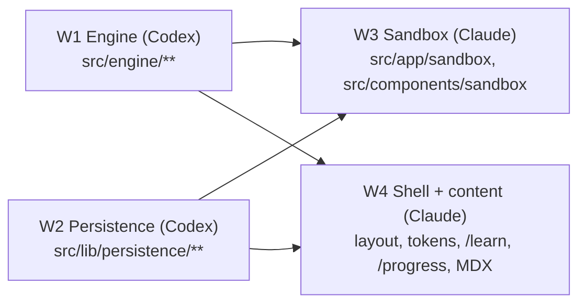

# Workstreams — P0 + P1 vertical slice

Parallel build of PLAN.md §21 P0/P1. Four workers share one working tree, so **each owns disjoint paths**.



## Rules for every worker

- Read `AGENTS.md` and the relevant guide in `node_modules/next/dist/docs/` before writing Next.js code (Next 16.4: `cacheComponents`, async `params`, React Compiler on).
- **Edit only paths you own.** Need something from another stream? Code against the contract below; leave a `// TODO(Wn):` note, don't edit their files.
- **Do not run `npm install`.** Every dependency is installed already: zod, @xyflow/react, roughjs, zustand, idb, lz-string, perfect-freehand, motion, gsap, @gsap/react, @next/mdx, @mdx-js/loader, @mdx-js/react, gray-matter; dev: vitest, fast-check, fake-indexeddb. Ask the lead if you truly need another.
- **Do not commit.** The lead integrates and commits.
- Verify with `npx tsc --noEmit` (ignore errors in other streams' paths), `npx vitest run <your paths>`, `npx eslint <your paths>`.
- Diagrams in Markdown are Mermaid only.

## Ownership

| Stream | Owner | Paths |
|---|---|---|
| W1 Engine | Codex | `src/engine/**` (contract `src/engine/types.ts` — additive changes only) |
| W2 Persistence | Codex | `src/lib/persistence/**` |
| W3 Sandbox + challenge | Claude | `src/app/sandbox/**`, `src/app/challenges/**`, `src/components/sandbox/**`, `src/lib/run-manager/**`, `src/content/challenges/**` |
| W4 Shell + content | Claude | `src/app/layout.tsx`, `src/app/page.tsx`, `src/app/globals.css`, `src/app/not-found.tsx`, `src/app/learn/**`, `src/app/progress/**`, `src/app/settings/**`, `src/app/reference/**`, `src/components/ui/**`, `src/components/lesson/**`, `src/lib/content/**`, `src/lib/format.ts`, `content/**`, `mdx-components.tsx`, `next.config.ts` |
| Lead | Claude (main) | `package.json`, `docs/**`, integration, commits |

## Contract: engine (W1 → W3, W4)

Types in `src/engine/types.ts`. Public API from `src/engine/index.ts`:

```ts
validateDesign(design, scenario): ValidationIssue[]
designHash(design): string
runToCompletion(design, scenario, seed, settings?): RunResult
createSimulation(design, scenario, seed, settings): Simulation
traceRequest(design, endpointId, key, seed, priorInputs): TraceResult
gradeChallenge(design, challenge): GradeReport
ENGINE_VERSION, REPLAY_COMPAT_ID
```

Worker: `src/engine/engine.worker.ts`, speaking `ToWorker` / `FromWorker`. The UI loads it with
`new Worker(new URL("../../engine/engine.worker.ts", import.meta.url), { type: "module" })`.

Fixtures W1 provides for everyone: `src/engine/fixtures.ts` exporting `cacheAsideDesign` (client → LB → 2 services → cache + DB, cache-aside handlers), `noCacheDesign`, and `cachingScenario` (Zipf reads, cache-node kill mid-run).

## Contract: persistence (W2 → W3, W4)

`src/lib/persistence/index.ts`:

```ts
type SaveStatus = "saved" | "saving" | "error";
openStore(): Promise<Store>                 // IndexedDB via idb; falls back to in-memory (store.persistent === false)
store.designs.list(): Promise<DesignRecord[]>
store.designs.get(id): Promise<DesignRecord | undefined>
store.designs.put(rec, expectedRevision): Promise<DesignRecord>   // atomic compare-and-put; throws RevisionConflict
store.designs.delete(id)
store.runs.add(run: RunRecord); store.runs.listForDesign(designId, limit = 10)
store.progress.get(itemId); store.progress.upsert(p: ProgressRecord)   // merge per item by max
store.progress.all()
store.settings.get(); store.settings.put(s)
exportBackup(): Promise<Blob>; importDesign(file: File): Promise<DesignRecord>; restoreBackup(file, mode)
encodeShareLink(design): string | null      // "#d=..." (lz-string, ≤ 8 KB compressed / 64 KB decompressed)
decodeShareLink(hash): Design | { error: string }
onExternalChange(cb): () => void            // BroadcastChannel notification only
```

`ProgressRecord = { itemId, kind: "lesson" | "step" | "objective" | "challenge", completedAt?, mastery?, stars?, revision }`.

## Contract: design tokens (W4 → W3)

CSS custom properties on `:root` (dark-first, light via `[data-theme="light"]`):
`--bg --surface --surface-2 --border --text --text-muted --accent --accent-2 --danger --warning --success --radius-sm --radius --radius-lg`.
Fonts: `--font-sans` (Geist Sans), `--font-mono` (Geist Mono). Tailwind v4 `@theme` maps them (`bg-surface`, `text-muted`, …).

## P1 exit (PLAN §21)

A learner completes the caching lesson, builds a cache-aside design, survives a cache-node kill, passes the challenge, and reloads with progress intact.
