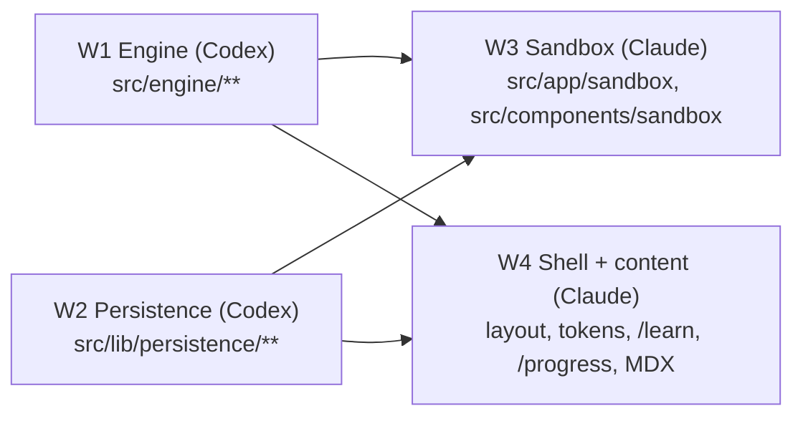
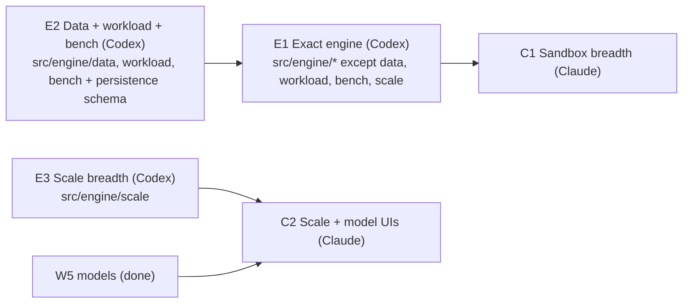

# Workstreams — P0 + P1 vertical slice

Parallel build of PLAN.md §21 P0/P1. Four workers share one working tree, so **each owns disjoint paths**.



## Rules for every worker

- Read `AGENTS.md` and the relevant guide in `node_modules/next/dist/docs/` before writing Next.js code (Next 16.4: `cacheComponents`, async `params`, React Compiler on).
- **Edit only paths you own.** Need something from another stream? Code against the contract below; leave a `// TODO(Wn):` note, don't edit their files.
- **Do not run `npm install`.** Every dependency is installed already: zod, @xyflow/react, roughjs, zustand, idb, lz-string, perfect-freehand, motion, gsap, @gsap/react, @next/mdx, @mdx-js/loader, @mdx-js/react, gray-matter; dev: vitest, fast-check, fake-indexeddb. Ask the lead if you truly need another.
- **Do not commit.** The lead integrates and commits.
- Verify with `npx tsc --noEmit` (ignore errors in other streams' paths), `npx vitest run <your paths>`, `npx eslint <your paths>`.
- Diagrams in Markdown are Mermaid only.

## Ownership

| Stream | Owner | Paths |
|---|---|---|
| W1 Engine | Codex | `src/engine/**` (contract `src/engine/types.ts` — additive changes only) |
| W2 Persistence | Codex | `src/lib/persistence/**` |
| W3 Sandbox + challenge | Claude | `src/app/sandbox/**`, `src/app/challenges/**`, `src/components/sandbox/**`, `src/lib/run-manager/**`, `src/content/challenges/**` |
| W4 Shell + content | Claude | `src/app/layout.tsx`, `src/app/page.tsx`, `src/app/globals.css`, `src/app/not-found.tsx`, `src/app/learn/**`, `src/app/progress/**`, `src/app/settings/**`, `src/app/reference/**`, `src/components/ui/**`, `src/components/lesson/**`, `src/lib/content/**`, `src/lib/format.ts`, `content/**`, `mdx-components.tsx`, `next.config.ts` |
| W5 Focused models | Codex | `src/models/**` (PLAN §6: `Model<S, A>` interface, hash ring, isolation scheduler) |
| W6 Scale mode | Codex | `src/engine/scale/**` (PLAN §5A; reads `src/engine/types.ts`, never edits Exact-mode files) |
| Lead | Claude (main) | `package.json`, `docs/**`, integration, commits |

## Contract: engine (W1 → W3, W4)

Types in `src/engine/types.ts`. Public API from `src/engine/index.ts`:

```ts
validateDesign(design, scenario): ValidationIssue[]
designHash(design): string
runToCompletion(design, scenario, seed, settings?): RunResult
createSimulation(design, scenario, seed, settings): Simulation
traceRequest(design, endpointId, key, seed, priorInputs): TraceResult
gradeChallenge(design, challenge): GradeReport
ENGINE_VERSION, REPLAY_COMPAT_ID
```

Worker: `src/engine/engine.worker.ts`, speaking `ToWorker` / `FromWorker`. The UI loads it with
`new Worker(new URL("../../engine/engine.worker.ts", import.meta.url), { type: "module" })`.

Fixtures W1 provides for everyone: `src/engine/fixtures.ts` exporting `cacheAsideDesign` (client → LB → 2 services → cache + DB, cache-aside handlers), `noCacheDesign`, and `cachingScenario` (Zipf reads, cache-node kill mid-run).

## Contract: persistence (W2 → W3, W4)

`src/lib/persistence/index.ts`:

```ts
type SaveStatus = "saved" | "saving" | "error";
openStore(): Promise<Store>                 // IndexedDB via idb; falls back to in-memory (store.persistent === false)
store.designs.list(): Promise<DesignRecord[]>
store.designs.get(id): Promise<DesignRecord | undefined>
store.designs.put(rec, expectedRevision): Promise<DesignRecord>   // atomic compare-and-put; throws RevisionConflict
store.designs.delete(id)
store.runs.add(run: RunRecord); store.runs.listForDesign(designId, limit = 10)
store.progress.get(itemId); store.progress.upsert(p: ProgressRecord)   // merge per item by max
store.progress.all()
store.settings.get(); store.settings.put(s)
exportBackup(): Promise<Blob>; importDesign(file: File): Promise<DesignRecord>; restoreBackup(file, mode)
encodeShareLink(design): string | null      // "#d=..." (lz-string, ≤ 8 KB compressed / 64 KB decompressed)
decodeShareLink(hash): Design | { error: string }
onExternalChange(cb): () => void            // BroadcastChannel notification only
```

`ProgressRecord = { itemId, kind: "lesson" | "step" | "objective" | "challenge", completedAt?, mastery?, stars?, revision }`.

## Contract: design tokens (W4 → W3)

CSS custom properties on `:root` (dark-first, light via `[data-theme="light"]`):
`--bg --surface --surface-2 --border --text --text-muted --accent --accent-2 --danger --warning --success --radius-sm --radius --radius-lg`.
Fonts: `--font-sans` (Geist Sans), `--font-mono` (Geist Mono). Tailwind v4 `@theme` maps them (`bg-surface`, `text-muted`, …).

## P1 exit (PLAN §21)

A learner completes the caching lesson, builds a cache-aside design, survives a cache-node kill, passes the challenge, and reloads with progress intact.

---

# P2 — Engine breadth (+ Scale/model UIs)

P1 is merged on `p1-vertical-slice`. The P2 contract additions are in `src/engine/types.ts` (search for `P2`). Every addition is optional or a new union member, so P1 designs stay valid. The rules above still apply: own your paths, no `npm install` (`elkjs` is now installed), no commits.



| Stream | Owner | Paths |
|---|---|---|
| E1 Exact engine | Codex | `src/engine/*.ts` (top level: simulation, validation, grading, worker, core, fixtures, index, tests), `src/engine/types.ts` (additive only, log in `CHANGES.md`) |
| E2 Data, workload, bench | Codex | `src/engine/data/**`, `src/engine/workload/**`, `src/engine/bench/**`, `src/lib/persistence/schemas.ts` (accept P2 Design fields) |
| E3 Scale breadth | Codex | `src/engine/scale/**` |
| C1 Sandbox breadth | Claude | `src/app/sandbox/**`, `src/app/challenges/**`, `src/components/sandbox/**`, `src/lib/run-manager/**`, `src/content/challenges/**` |
| C2 Scale + model UIs | Claude | `src/components/scale/**`, `src/components/models/**`, `src/app/dev/**`, `src/lib/content/schema.ts` (`widgetSchemas` entries only) and `mdx-components.tsx` (`implementations` entries only) |

## Contract: E2 modules → E1

E2 builds pure modules; E1 calls them. If E2 has not landed yet, E1 keeps a minimal inline version behind the same signature and switches to the import when the module appears.

```ts
// src/engine/data/index.ts
createDataStore(entity: EntitySpec, rng: Random): DataStore      // dataset generated from the run seed, reset each run
DataStore.apply(op: DataOp, key: string, nowUs): { status: Status; version?: number; found: boolean; rowsScanned: number; costUnits: number }
DataStore.snapshotVersion(key): number | undefined                // used by staleRead/ackedWriteLost checks
dataCostUs(op, entity, base: Dist-sampled µs): number            // indexed: base + log2(n) + limit×perRow; unindexed: ∝ count
// src/engine/workload/index.ts
arrivalRate(arrival, tUs): number                                // rps at t for every Workload.arrival kind
sampleInput(gen: InputGen, rng): number | string; renderKey(template, inputs): string
parseReplayCsv(text): { points } | { error }                      // validated, size-limited
toPeakRps(perDay: number, peakFactor: number): { avgRps, peakRps } // "1B requests/day"
// src/engine/bench/
npm run bench -> S/M/L scenarios (§18), events/s vs baseline.json, fail > 15% regression
golden.test.ts -> golden run hashes; fails if a hash changes without REPLAY_COMPAT_ID bump
```

## Contract: Scale panel (C2 → C1)

```ts
// src/components/scale/index.ts (client component, runs Scale mode in its own worker)
<ScalePanel design={Design} scenario={Scenario} onHeat={(heat: Record<NodeId, number> | null) => void} />
```

C1 mounts it as a **Scale** tab in the editor and paints `onHeat` values (0..1+) as node heat on the board during failure-ladder playback.

## P2 exit

All components of §5.3 run in Exact mode with contended links, the full chaos set, all correctness invariants, replication/failover and live edits. Learners can define data models and endpoints (§8A.1–8A.2), edit workloads and chaos, export designs, and run Scale mode from the sandbox. Benchmarks and golden runs are in CI-ready scripts. Every new behaviour has a must-trigger and a must-not-trigger test.
