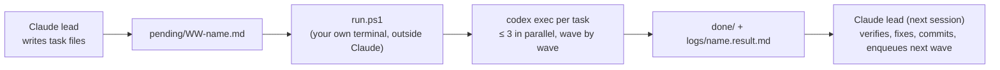

# Codex queue (the build loop)

Claude (the lead) plans the work and verifies, merges and commits it. Codex executes queued tasks, even while Claude is rate-limited.



- **Task file**: a full, self-contained Codex prompt. Name it `WW-name.md`; `WW` is a two-digit wave. Wave N+1 starts only after every wave ≤ N task has finished, so put dependent work in a later wave.
- **Start or restart**: run this in your own PowerShell window, not inside Claude, so it outlives Claude's session:

  ```powershell
  powershell -NoProfile -ExecutionPolicy Bypass -File E:\system-design-simulation\ops\codex-queue\run.ps1
  ```

  Leave the window open; it exits by itself when the queue is empty. If a runner is already alive, the lock file makes a second start exit immediately.
- **HOLD gate**: while the file `ops/codex-queue/HOLD` exists, the runner waits and starts nothing new. The lead creates it while interactive (non-queue) workers are still landing and deletes it when their work is merged. If the lead is offline and those workers have finished (`git status` is clean, or nothing is changing), delete `HOLD` yourself to let the queue proceed.
- **Results**: `logs/<name>.result.md` holds Codex's final summary, and `logs/<name>.log` the full transcript. Exit 0 moves the task to `done/`; anything else moves it to `failed/`.
- **Rules every task inherits**: follow `docs/WORKSTREAMS.md` (owned paths, no commits). Codex never commits; the lead verifies and commits.
- **Interrupted task**: if a task sits in `running/` with no live runner, move it back to `pending/` and restart the runner, or resume it with `codex exec resume <session id from its log>`.
